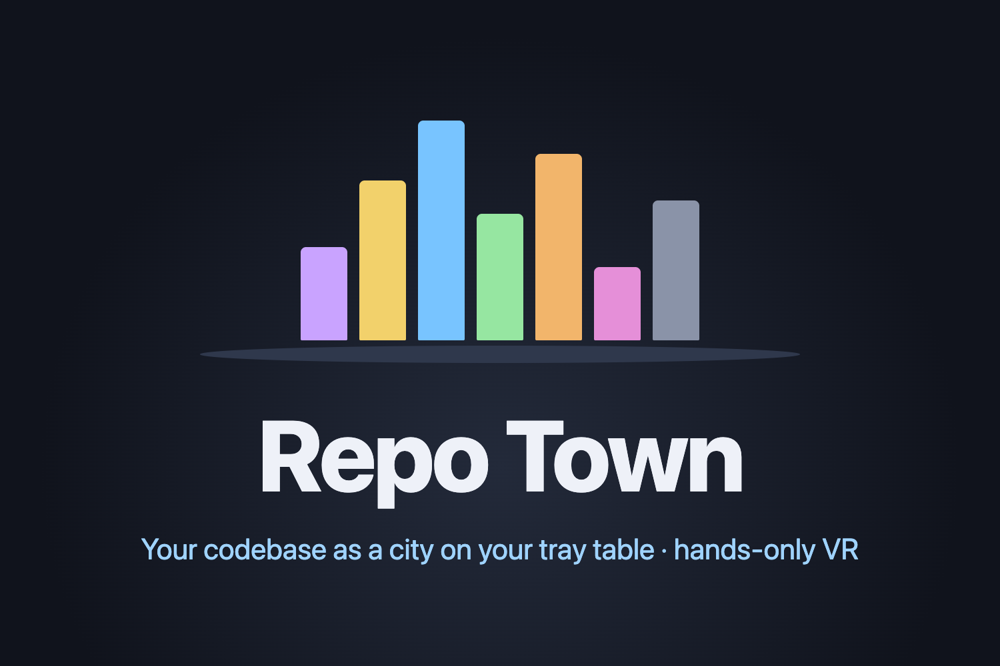
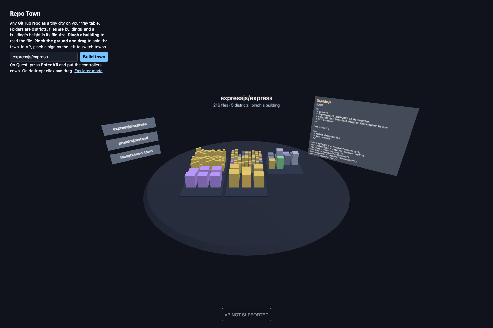

# Repo Town

Any GitHub repo as a tiny city on your tray table, built for Meta Quest hand tracking with WebXR.

**Play:** https://fozagtx.github.io/repo-town/ (Meta Quest Browser → Enter VR → put the controllers down)
**Any repo:** https://fozagtx.github.io/repo-town/?repo=owner/name

- **Folders are districts, files are buildings.** Height is file size (log scale), colour is file type.
- **Pinch a building** to open the file on a floating card beside the table.
- **Pinch the ground and drag** to spin the town.
- **Pinch a sign** to switch to another repo without leaving VR.
- **Seated:** the town sits 35 cm below and 50 cm in front of your head, inside a two-foot radius.

Stack: three.js r170 (CDN, no build) · WebXR Hand Input · GitHub REST tree API · Web Audio · GitHub Pages.
Meta VR Start Developer Competition 2026 · Productivity · New Experience.
